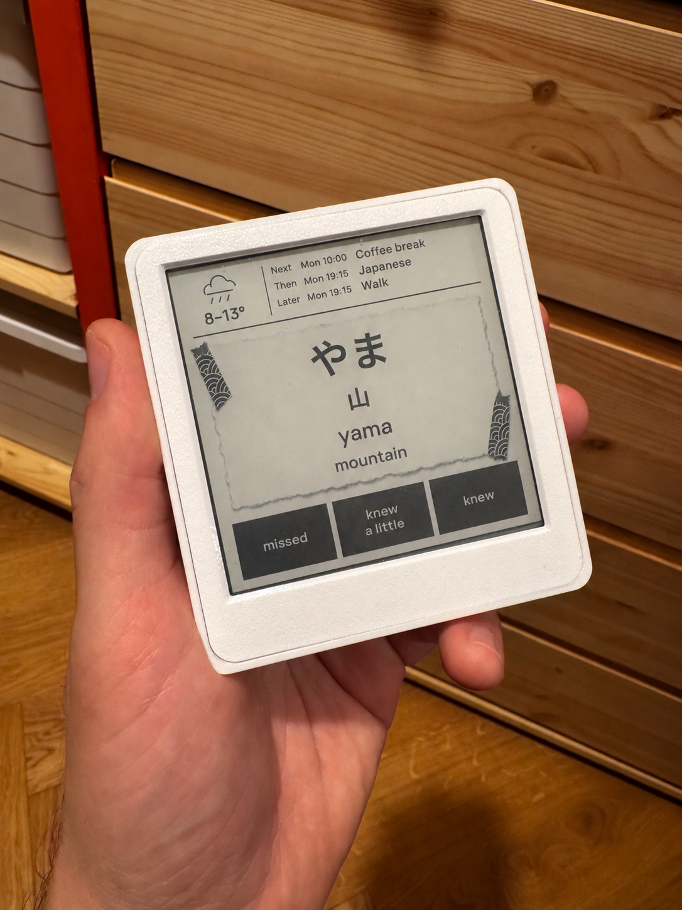

# 🪨 Enkiplate

Japanese flashcards on e-paper. A little torn paper, a little washi, one thing to learn.

Enkiplate turns an **Inkplate 4TEMPERA** into a Japanese study companion for your desk. Read the card, tap to reveal it, then tell it how you did. It remembers what needs practice. Today's weather and your next three calendar events sit above the card.

<p align="center">
  
</p>

*Real device photograph. Calendar titles replaced with sample events for privacy.*

## What it does

- **Kana → words → kanji → sentences.** Start with hiragana and katakana, or skip ahead. Familiar words show their common kanji too: ねこ / 猫, いぬ / 犬, やま / 山.
- **Spaced repetition.** FSRS schedules reviews at a target 90% retention. The starting pace is 12 new cards a day. Change the level, pace and automatic progression in the browser.
- **Room to grow.** A curated foundation, 12,000 common JMdict entries and your own JSON imports. No generative model or AI subscription is required.
- **A forgiving connection.** Up to 16 complete cards are cached on the device. Answers are saved before advancing and synced with stable IDs. An interrupted connection keeps your progress.
- **A small view of the day.** Today's outdoor low and high, a weather symbol, and the next three timed calendar events. The current location is Bratislava.
- **Fourteen screen designs.** Wave washi is the default. There are also terminal, large-print and lighter cutout directions, with matching touch targets.

No streaks. No accounts. No push notifications.

## Try it in a browser first

You need **Python 3.11+** and [uv](https://docs.astral.sh/uv/getting-started/installation/). macOS is the tested host; the companion service also uses standard Linux-compatible Python libraries. Windows is not currently supported.

```sh
git clone https://github.com/virpo/enkiplate.git
cd enkiplate
uv sync --frozen
uv run enki setup
uv run enki serve
```

Open **http://localhost:8787**. This is the working companion app, with the same 600 × 600, eight-shade images sent to the hardware. Choose a screen at **http://localhost:8787/designs**.

`setup` downloads the JMdict English source and imports common entries. Full Japanese and Latin fonts are included. Run it again safely; existing review history is preserved. The first dictionary download needs internet access.

1. Say the reading and, for words and sentences, the meaning.
2. Tap **Reveal**.
3. Grade the weaker part: **missed**, **knew a little**, or **knew**.

## Put it on an Inkplate

The supported device is the **Soldered Inkplate 4TEMPERA**, with a 600 × 600 touchscreen, ESP32, 4 MB flash and PSRAM. Other Inkplates need a firmware port.

Follow the [firmware setup and safe flashing instructions](firmware/README.md). Then run the companion on your trusted network:

```sh
uv run enki serve --host 0.0.0.0
```

Open the local app, choose **Inkplate → Connect USB**, and enter your Wi-Fi credentials. The app sends the server address and a private device key over USB. Credentials remain in the device's NVS. Keep the host awake and reachable for fresh cards; reserve its LAN address in your router.

The companion can also transfer cards and receive touch answers over USB. Disconnect USB in the app before flashing. The first USB load is slow at 115200 baud.

## Weather and calendar

[Open-Meteo](https://open-meteo.com/) supplies the daily temperature range and symbol, refreshed every 30 minutes. This first version uses Bratislava coordinates and `Europe/Bratislava` time. To adapt it, change `HOME_TIMEZONE` in [config.py](enki_core/config.py) and the coordinates in [context.py](enki_core/context.py).

In **Calendar**, add an optional private HTTPS `.ics` feed. For Google Calendar, use **Settings → your calendar → Integrate calendar → Secret address in iCal format**. Treat that link like a password. A fresh installation has no calendar connected.

The service refreshes events every 10 minutes and shows the next three timed events, including ongoing ones. It expands recurring events and occurrence overrides, skips all-day and cancelled events, and lets you exclude exact titles or event UIDs. No calendar content goes to an AI service. The device hides cached context after two hours or when its clock is unknown.

## Keep learning

Use **Learning** to pick your starting level. The selected level is a floor: choosing words skips kana while retaining their history. Settings normally reach an online device within 15 seconds.

Import verified vocabulary or short sentences when you want more:

```sh
uv run enki import my-cards.json
```

See the [example card file](docs/personal-cards.example.json). Imports are checked against the real paper layout before saving. Stable card IDs preserve learning history. Personal imports enter at stage 4 and take priority over new dictionary entries once that stage is open.

## Your data

Everything lives in the ignored `data/` directory. Set `ENKI_DATA_DIR` to use another location. It contains the SQLite database, device key, optional calendar URL, logs, backups and any hardware flash backups. Keep it private.

Download a consistent backup from **Your data**, or run:

```sh
uv run enki backup ~/Downloads/enkiplate-backup.sqlite3
```

The service retains 14 automatic daily backups. Manual backups are not pruned. To restore, stop the service, preserve the old data directory, copy the backup to `data/enki.sqlite3`, and retain `data/device-token` so the device can reconnect. Keep `data/` when updating.

Answers that cannot be applied safely are preserved in a recovery table and can be downloaded from **Your data**. They are included in backups.

## Start at login on macOS

Stop any manually running server, then:

```sh
uv run python scripts/install_service.py
```

This installs a user LaunchAgent, without administrator privileges. The Mac still needs to be awake. Stop it with `launchctl bootout gui/$(id -u)/io.virpo.enki`.

## How it fits together

```text
Inkplate touchscreen                 Companion on your computer
┌──────────────────────┐    Wi-Fi     ┌──────────────────────────┐
│ cached card images   │◀────────────▶│ FastAPI + Pillow renderer│
│ persistent answers   │   or USB    │ FSRS + SQLite            │
│ weather + 3 events   │             │ JMdict + weather + ICS   │
└──────────────────────┘             └──────────────────────────┘
```

The host renders typography, paper and touch targets into 3-bit frames. Firmware verifies compressed frames before committing a new batch. It refills when six cards remain and retains pending answers across restarts.

## Limits worth knowing

- **The cache is finite.** It holds up to 16 cards, not the full dictionary. The host is needed to refill it. You can keep adding content without changing firmware.
- **This is a desk device.** The display stays awake. Battery life has not been measured. Firmware updates use USB; OTA and sleep are not implemented.
- **Use a trusted LAN.** The hardware uses local HTTP and a device key. Do not expose port 8787 to the internet. Loopback access assumes other local users and processes are trusted.
- **Source checkout is the supported installation.** The renderer needs the repository's `enki/assets/` and `web/` directories. A standalone wheel is not a complete distribution.
- **Japanese material needs judgment.** Dictionary glosses are shortened. Imports should have checked readings and meanings, especially particles in sentences.

## Develop and check

```sh
uv sync --frozen
uv run pytest -q
uv run ruff check enki_core --select F,E9
node --test tests/js/state.test.mjs
uv run python scripts/render_washi_ready.py
```

Python tests cover scheduling, migrations, calendar recurrence, imports, screen fit, compressed frame integrity, session refill and flash layout protection. Native tests use the pinned ArduinoJson and Inkplate library headers when installed. CI fetches those sources to run both native checks.

`scripts/render_washi_ready.py` exports representative screens without recording reviews. The browser design picker also uses sample events. Read [verification notes](docs/VERIFICATION.md) for what has been checked on real hardware.

## License and credits

Original application code, documentation, photograph and material artwork are available under the [MIT License](LICENSE). Third-party fonts, dictionary data and linked firmware libraries retain their own licenses. See [NOTICE.md](NOTICE.md).

- [JMdict / Electronic Dictionary Research and Development Group](https://www.edrdg.org/edrdg/licence.html): CC BY-SA 4.0. Imported dictionary data retains this license.
- [Open-Meteo](https://open-meteo.com/en/licence): forecast data under CC BY 4.0, rounded for display.
- [Noto Sans JP, Manrope and IBM Plex Mono](enki/assets/production/README.md): SIL Open Font License 1.1.
- [Soldered Inkplate library](https://github.com/SolderedElectronics/Inkplate-Arduino-library): LGPL-3.0. Firmware build instructions pin the library source.

An independent project by [Peter Hraska](https://github.com/virpo). More builds: [@virpo on X](https://x.com/virpo).

Not affiliated with Soldered, Anki or the dictionary publishers.
